<p align="center">
  
</p>

<p align="center">
  <b>A landing page printed like a banknote.</b><br>
  Intaglio engravings that breathe, a loupe for the fine lines, a UV lamp for the hidden fibres<br>
  and a table note that prints itself when you book.
</p>

<p align="center">
  
  
  
  
  
  
</p>

> [!IMPORTANT]
> **Shiosai is not a real restaurant.** It is a fictional seafood house, designed and built for fun as a portfolio project. No table can be booked, no deposit is taken and no boat goes out. Every name, price and tide in it belongs to the story.

<p align="center">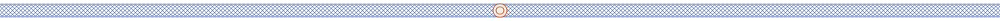</p>

## Plate 0 · The boat

Shiosai 潮騒 means *the sound of the waves*. The idea is simple: a twenty two seat dining room on a pier, whose own boat goes out at five in the morning, and whose menu is written by whatever the sea gives back. So the page reads like the sea's own currency. Every section is a plate of one banknote series, numbered, serialised and engraved.

<p align="center">
  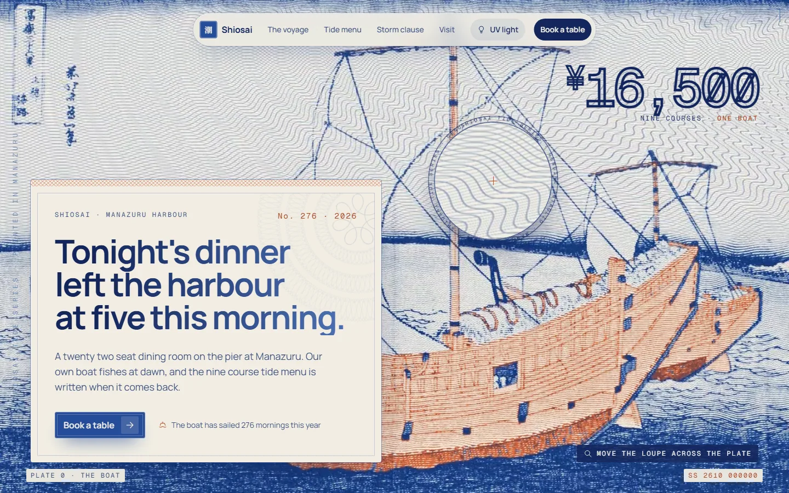
</p>

The hero is not a photo. It is a **living engraving**: a print after Hokusai's ship off Kazusa, redrawn line by line in cobalt and copper, where only the water moves. The swell travels through the engraved lines on a slow, seamless eight second loop while the ship holds still on top of it.

<p align="center"></p>

## The security features

Real banknotes hide their best work in details you only find when you look closely. So does this page.

<table>
  <tr>
    <td width="50%">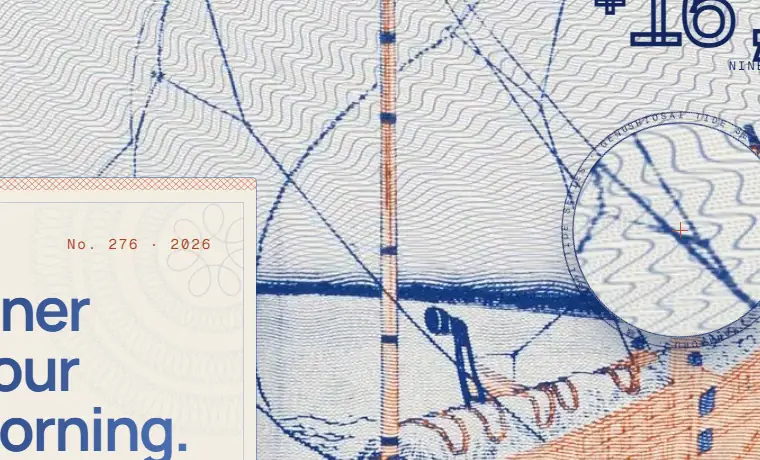</td>
    <td width="50%">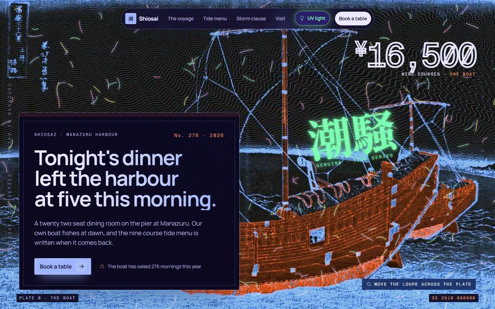</td>
  </tr>
  <tr>
    <td><b>🔍 The loupe</b><br>Move the cursor over the hero and a jeweller's loupe follows it, magnifying the plate 2.6 times while the micro text on its rim slowly turns.</td>
    <td><b>💡 UV light</b><br>Switch the lamp on in the nav. The paper goes violet, the ink glows, fluorescent fibres appear in the stock and hidden marks rise to the surface.</td>
  </tr>
</table>

| Feature | On a real note | On this page |
| :-- | :-- | :-- |
| **Guilloche** | Interlaced curves no copier can reproduce | Rosettes, border bands and the sky mesh are drawn from parametric curves |
| **Intaglio** | Raised lines whose width carries the tone | Every image is redrawn as lines that swell in the shadows and bend over the shapes |
| **Watermark** | A mark you only see against the light | *Hold it to the light* in the storm clause reveals 潮 in an oval window |
| **Serial number** | Unique to every note | The corner serial counts up as you scroll, and every booking prints a new one |
| **Micro text** | Lines too small to read without a lens | The side frame and the loupe rim carry the series name in micro type |
| **UV fibres** | Invisible threads that glow under ultraviolet | Hidden layers that only exist while the lamp is on |

<p align="center"></p>

## Plate I · The voyage

One day of the boat, printed as a series of four notes: **05:10** the departure, **07:40** the nets, **11:20** back in harbour, **17:30** the table. Drag through them like cards on a table. Each note has its own ink, and the moving ones are real footage slowed to half speed and engraved frame by frame.

<p align="center">
  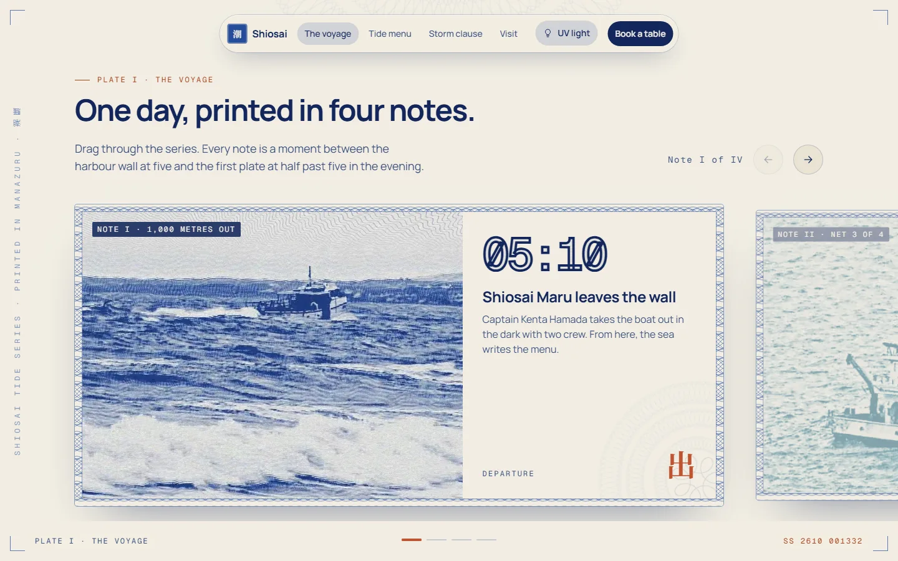
</p>

## Plate II · The tide menu

Nine courses, and each one has a catch time. Hover a course and its engraved plate follows the cursor. The side plate is a print after Hiroshige's Kuroto bay.

<p align="center">
  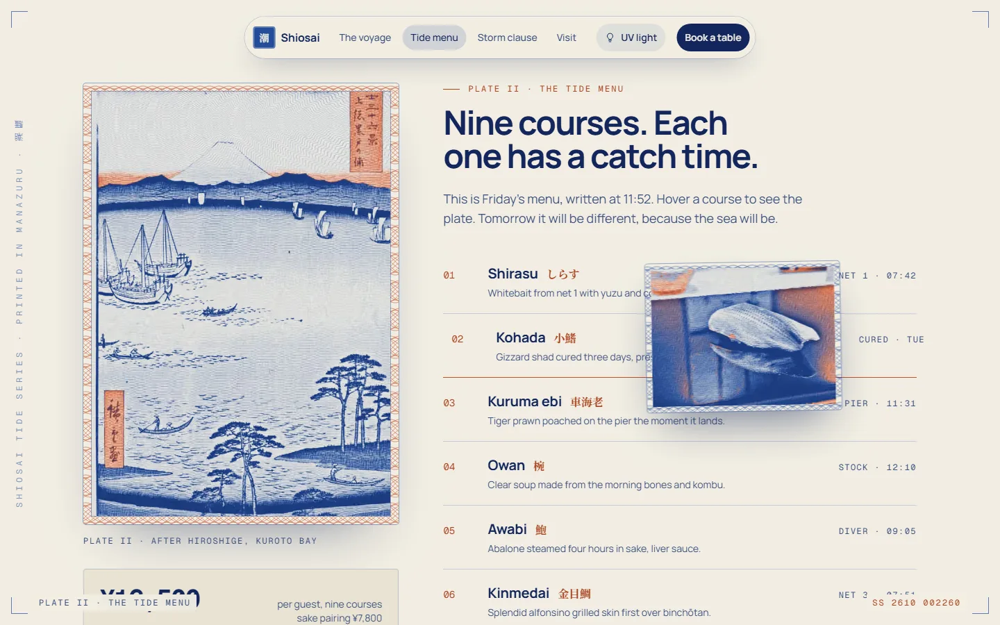
</p>

## Plate III · The storm clause

When the sea says no, the restaurant closes, and the page says so plainly. A night engraving of a lighthouse in a storm, three numbers, and a watermark that only appears when you hold the note to the light.

<p align="center">
  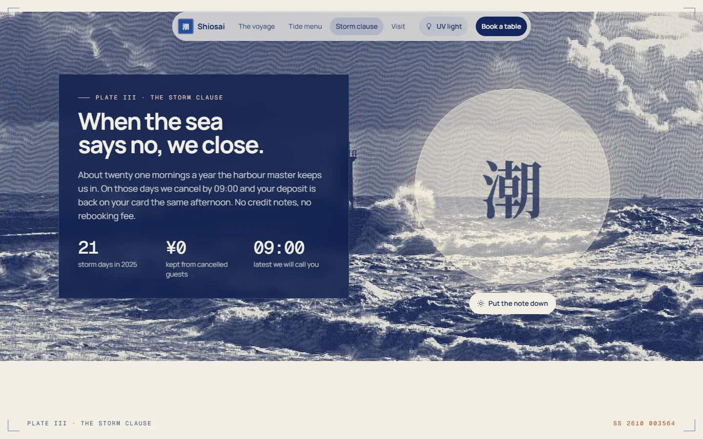
</p>

## Plate V · Book a table

A booking form shaped like a perforated bond. Dates, seatings and guests come from a pure domain module, the email is checked in the browser and again in a server action, and a successful booking prints a small engraved ticket with its own serial and a 発 stamp.

<p align="center">
  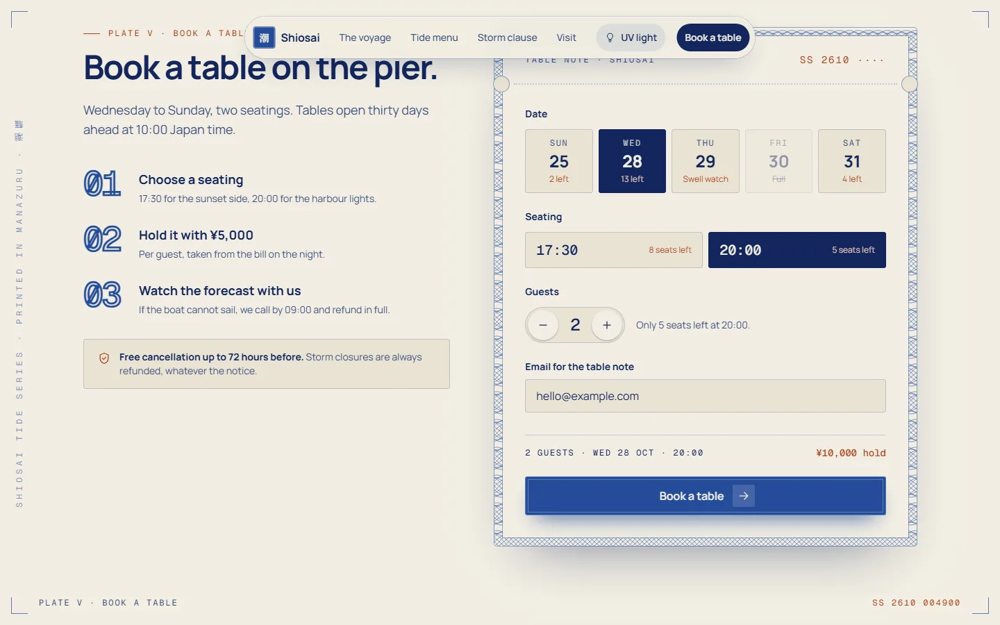
</p>

<table>
  <tr>
    <td width="62%">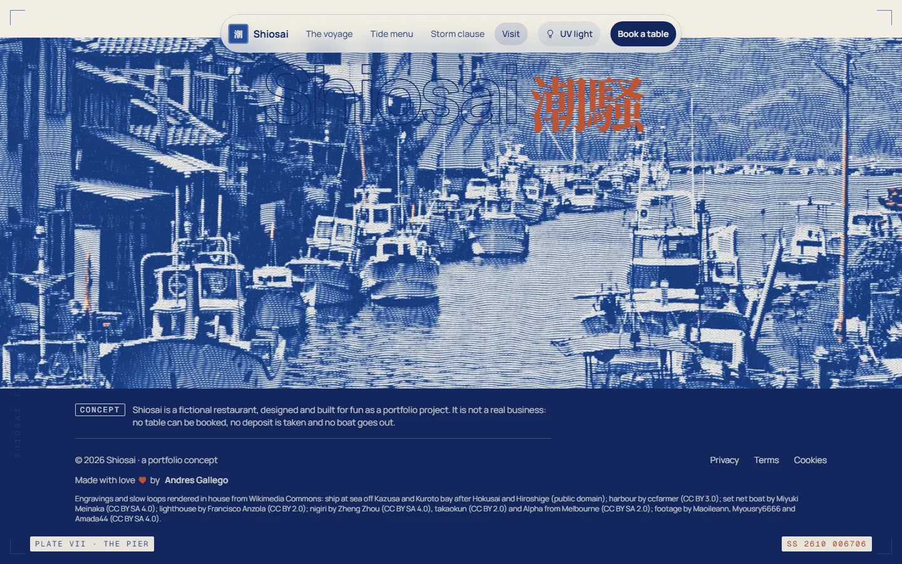</td>
    <td width="38%" align="center">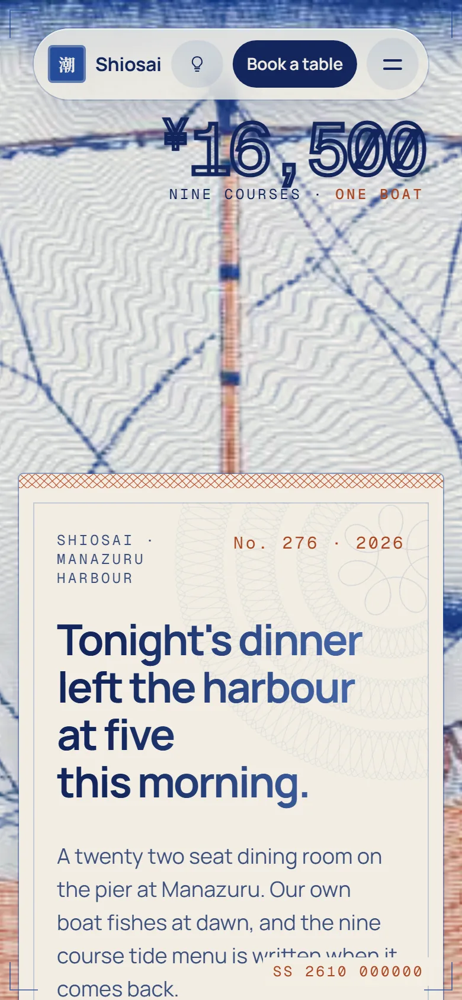</td>
  </tr>
  <tr>
    <td><b>Plate VII · The pier.</b> The page ends on a moored harbour, under a wordmark filled with drifting guilloche.</td>
    <td><b>Pocket edition.</b> Every plate reflows for a phone.</td>
  </tr>
</table>

<p align="center"></p>

## How the engravings are made

None of the images are filters applied in the browser. Each one went through an offline engraving pass before it reached `public/`:

```
  photo or woodblock print
          │
          ▼
  tone map ────── levels, local contrast, sky detection
          │
          ▼
  line field ──── parallel lines displaced by the image's low frequencies,
          │       so they bend over hulls, waves and mountains
          ▼
  intaglio ────── line width follows darkness, cross hatching joins in the shadows
          │
          ▼
  guilloche sky ─ two interlaced sine families replace flat skies
          │
          ▼
  two inks ────── cobalt for tone, copper for the warm hues, cream paper
          │
          ▼
  motion ──────── water masks move on a periodic phase for seamless loops,
                  real footage is slowed, engraved per frame and cross faded
```

<p align="center"></p>

## Under the hood

| | |
| :-- | :-- |
| **Framework** | Next.js 16 App Router, React 19.3 with the React Compiler, Server Components by default |
| **Styling** | CSS Modules over a single token file, with a full UV theme swapped through custom properties |
| **Motion** | CSS and a tiny scroll loop, custom easing everywhere, `prefers-reduced-motion` respected on every animation |
| **Media** | Videos only play while on screen, posters load first, fonts are self hosted through `next/font` |
| **Domain** | Booking rules live in `src/core` as pure, tested functions, with availability served from `src/server` |
| **SEO** | Metadata, Open Graph image, sitemap, robots and FAQ structured data |
| **Quality** | Biome, strict TypeScript, Vitest, Playwright end to end with axe accessibility checks, lefthook on every commit |

### Run it

```bash
pnpm install
pnpm dev          # http://localhost:3000
pnpm verify       # lint, typecheck, unit tests and production build
pnpm test:e2e     # Playwright, run pnpm test:e2e:install once first
```

### Map of the plates

```
src/
├─ app/                   layout, page, 404, metadata, tokens and fonts
├─ components/
│  ├─ sections/           one folder per plate: hero, voyage, tide-menu, storm, booking…
│  ├─ motion/             reveal, on screen video, scroll helpers
│  ├─ seo/                structured data
│  └─ ui/                 icons and primitives
├─ content/site.ts        every word on the page
├─ core/                  booking rules, pure and tested
└─ server/                availability
spec/                     the plan: scope, architecture, motion, quality gates and tasks
public/engraving/         guilloche ornaments as SVG
public/media/             engraved stills and living loops
```

<p align="center"></p>

## Credits

Every engraving and loop was rendered from openly licensed media on Wikimedia Commons:

- Ship at sea off Kazusa after **Katsushika Hokusai** and Kuroto bay after **Utagawa Hiroshige**, public domain
- Fishing harbour by **ccfarmer**, CC BY 3.0
- Set net boat off Enoshima by **Miyuki Meinaka**, CC BY SA 4.0
- Lighthouse in rough sea by **Francisco Anzola**, CC BY 2.0
- Nigiri by **Zheng Zhou** (CC BY SA 4.0), **takaokun** (CC BY 2.0) and **Alpha from Melbourne** (CC BY SA 2.0)
- Footage by **Maoileann**, **Myousry6666** and **Amada44**, CC BY SA 4.0

<p align="center"></p>

<p align="center">
  <sub>SS 2610 · PLATE VII · THE PIER</sub><br><br>
  Made with ❤️ by <a href="https://github.com/andresfgzdev"><b>Andres Gallego</b></a><br>
  <sub>A portfolio concept. Not a real business.</sub>
</p>
